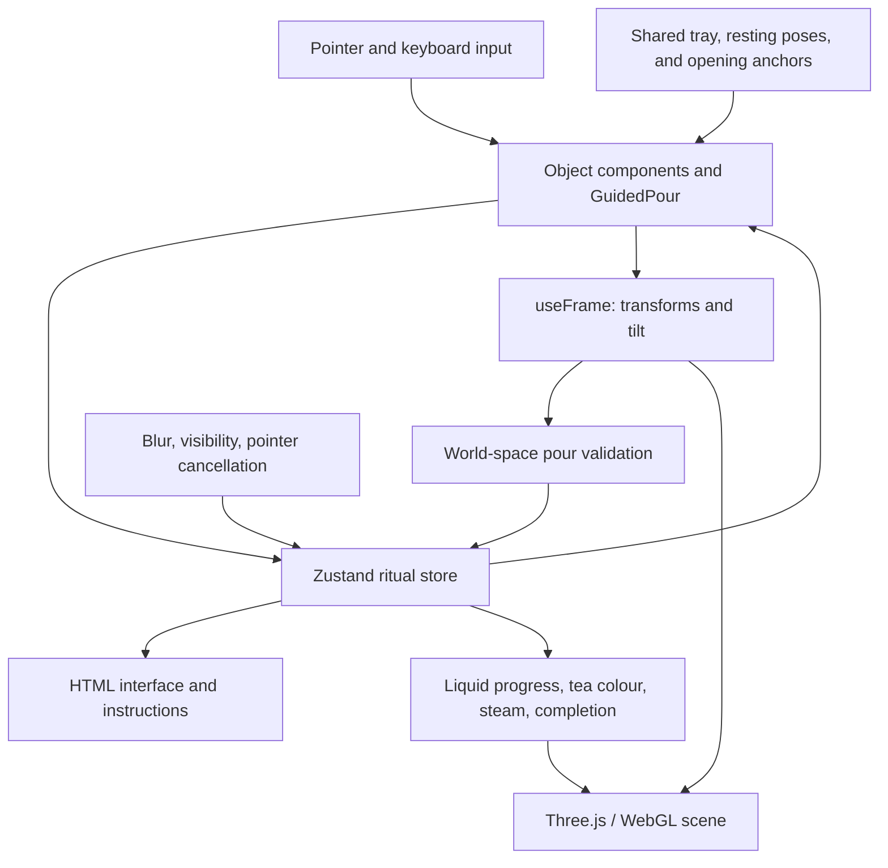

# OjaTea — Technical Design

Updated: 24 October 2026. This document describes the implementation currently in this repository and the boundaries for the next visual-production phase.

## 1. Product and implementation scope

OjaTea is an atmospheric, seated, first-person sencha ritual. The visitor opens a caddy, adds two scoops of leaves, pours water into a side-handled kyūsu, waits for steeping, pours tea into a cup, and takes a sip. Completion offers a quiet pause and a restart.

The application currently contains a complete ceremony using procedural placeholder geometry. Guided movement handles object positioning; the visitor controls the meaningful actions, including holding to pour or sip. Desktop mouse and keyboard are the primary inputs. Narrow and portrait layouts provide responsive presentation, with full touch controls reserved for a later phase.

The application runs entirely in the browser. There is no backend, database, authentication, routing system, account state, or persistent session storage. Refreshing the page resets the experience. The production output is a static `dist/` directory; no production hosting configuration has been added.

## 2. Technology stack

Versions below reflect declarations in [package.json](package.json). [package-lock.json](package-lock.json) records the resolved dependency versions.

| Area | Technology | Current role |
| --- | --- | --- |
| Application | React 19.2.0, React DOM 19.2.0 | Component composition, entry screen, instructions, controls, and lifecycle management |
| Language | TypeScript `~5.9.3` | Strict types for ritual phases, interaction stages, layout data, and component contracts |
| Build tooling | Vite `^7.1.7`, npm | Development server, TSX/module transformation, production bundling, and dependency management |
| Rendering | Three.js 0.180.0 | WebGL rendering, geometry, materials, transforms, lighting, and vector calculations |
| React/3D integration | React Three Fiber 9.7.0 | Declarative scene graph, pointer events, render-loop callbacks, and renderer lifecycle |
| Scene helpers | Drei 10.7.8 | Environment lighting, contact shadows, rounded geometry, world-space HTML labels, and dust particles |
| Shared state | Zustand 5.0.8 | Ritual progression, interaction stages, preparation progress, and recovery actions |
| Animation | R3F `useFrame`, Three.js interpolation | Guided object paths, tilt, lid movement, camera easing, steam, and sipping |
| Interface | Plain CSS, Lucide React 0.468.0 | Responsive HTML overlay, icons, focus styles, progress display, and transitions |
| Typography | Google Fonts with system fallbacks | Manrope, DM Mono, and Newsreader |
| Unit tests | Vitest `^3.2.4` | Ceremony actions, state guards, pour geometry, and resting-surface checks |
| Browser tests | Playwright `^1.64.0` | Chromium ceremony flows, pointer/keyboard input, interruption recovery, and viewport checks |

TypeScript targets ES2022 with strict checking and bundler module resolution. `npm run build` runs `tsc -b` before Vite. `@vitejs/plugin-react` is installed, but there is currently no explicit Vite configuration enabling it.

XState, Rapier, GSAP, React Spring, Howler, and `@react-three/postprocessing` are not part of the current runtime. They appeared in the original implementation options; the prototype uses Zustand, direct interpolation, and the renderer's own tone mapping instead. Audio playback has not been implemented.

## 3. Architecture and data flow



There are three practical layers:

1. **Ritual state:** typed preparation data and guarded actions in the Zustand store determine which step and object interaction are active.
2. **Scene behavior:** object components and the reusable pour controller translate that state into transforms and effects. Positions and rotations live in Three.js object refs and are updated each frame.
3. **HTML interface:** the overlay subscribes to selected store fields and displays the current instruction, progress, controls, timer, and restart action.

Continuous object transforms are not stored in Zustand. Preparation progress is: render-loop callbacks submit validated transfer or timer updates, and React subscribers reflect those values. Small presentation details, such as an object's hover appearance, use local component state.

## 4. Source organization

| File | Responsibility |
| --- | --- |
| [src/main.tsx](src/main.tsx) | Mounts the React root in `StrictMode` and imports global styles |
| [src/App.tsx](src/App.tsx) | Composes the canvas and interface; currently also contains room, table, objects, camera, steam, steeping, and recovery components |
| [src/store.ts](src/store.ts) | Holds ceremony state, interaction stages, progress, completion actions, cancellation, recovery, and restart |
| [src/ritualMachine.ts](src/ritualMachine.ts) | Defines ritual step types and metadata: labels, instructions, required objects, targets, and next-step descriptions |
| [src/components/GuidedPour.tsx](src/components/GuidedPour.tsx) | Reusable guided approach, user-controlled tilt, settling, return, and stream rendering for both pouring vessels |
| [src/pourGeometry.ts](src/pourGeometry.ts) | Shared spatial and angular conditions used by transfer logic and visible streams |
| [src/sceneLayout.ts](src/sceneLayout.ts) | Tray surface, model resting heights, vessel openings, ready poses, removed-lid placement, and kyūsu body profile |
| [src/interaction.ts](src/interaction.ts) | Reduced-motion preference handling and keyboard-shortcut filtering |
| [src/components/SceneDiagnostics.tsx](src/components/SceneDiagnostics.tsx) | Development-only read-only scene and renderer telemetry for browser tests |
| [src/styles.css](src/styles.css) | Visual treatment, responsive overlay layout, focus styles, and reduced-motion CSS |
| [tests/e2e/phase2c.spec.ts](tests/e2e/phase2c.spec.ts) | Full ceremony, restart, interaction interruption, viewport, and reduced-motion scenarios |
| [tests/e2e/ritual.spec.ts](tests/e2e/ritual.spec.ts) | Entry and initial leaf-transfer smoke tests |
| [public/environment/README.md](public/environment/README.md) | Provenance of the locally bundled environment HDR |

`App.tsx` remains the main scene implementation file. The object components are logically separate functions within it, not yet individual model modules. There is no general-purpose interaction manager, physics layer, asset registry, or audio manager at this stage.

## 5. Ritual and interaction state

The top-level sequence is:

```text
introduction → addLeaves → pourWater → steeping → pourTea → drink → complete
```

| Step | Completion condition |
| --- | --- |
| Introduction | Enter the room; initialize ceremony data |
| Add leaves | Open the caddy, finish two scoop deposits, and return the scoop; the caddy then closes |
| Pour water | Reach the water-fill threshold and return the kettle home |
| Steeping | Accumulate 20 simulation seconds while the page is visible |
| Pour tea | Reach the cup-fill threshold and return the kyūsu home |
| Drink | Complete sip progress and return the cup home |
| Complete | Remain in the completion state until the visitor restarts |

The store maintains `activeStep`, `entered`, `caddyOpen`, `leafScoops`, `waterFill`, `cupFill`, `steepElapsed`, `drinkProgress`, `held`, and `hoveredObject`, plus separate choreography stages:

```text
Pour:  idle → approaching → readyToPour → pouring → returning → completed
                                      ↘ settling → readyToPour

Scoop: idle → toCaddyAbove → intoCaddy → outOfCaddy → toPot → returning → idle
       cancellation: cancelLift → cancelClear → returning

Drink: idle → approaching → ready → drinking → returning → completed
                                 ↖ release
```

Escape returns an active pouring vessel or cup. A partial sip returns to an available idle cup, preserving progress. Scoop cancellation lifts and clears the caddy before returning; it does not count an uncompleted deposit.

The state machine is implemented through TypeScript unions and Zustand action functions. `ritualMachine.ts` is descriptive metadata and testable sequence helpers; it is not an engine that automatically executes all transitions. Runtime advancement occurs explicitly in store actions, generally after an object has returned home. Some choreography setters are direct setters, so component input guards remain part of the transition contract.

Transfer actions reject wrong-step input, invalid numeric amounts, and inappropriate interaction stages. Pouring additionally requires `held`. Fill and drink progress are normalized to `0–1`; values reaching the `.98` completion threshold resolve to `1`. These are visual preparation fractions rather than a physical millilitre-based liquid model.

## 6. Input, motion, and recovery

The main gesture is **select → automatic approach → hold to act → automatic return**.

- Click or Enter selects the required object and starts its guided approach.
- Holding the primary pointer button or Space controls pouring or sipping.
- Releasing pauses the action and settles the vessel upright, or makes the cup ready to resume.
- Escape cancels the current gesture and returns the object safely.
- Dragging empty space provides bounded camera look while object gestures are idle.

`GuidedPour` accepts the home and ready poses, source-local spout offset, world-space target opening, target radius, pour angle, stream colour, and state/transfer callbacks. Kettle and kyūsu share the pour-stage field, but only the enabled vessel may process motion or input.

Motion uses exponential interpolation, `1 - exp(-delta * speed)`, with refs updated inside `useFrame`. Pouring vessels interpolate to configured ready poses; scoop motion follows several waypoints; the cup approaches a camera-relative pose. Return completion snaps objects to their exact home transforms. There is no rigid-body simulation, collision solver, or unrestricted six-axis dragging.

Camera handlers consult the current store synchronously on pointer events to avoid letting a grab gesture move the view. Camera position and orientation updates pause during object choreography. Responsive framing and portrait sip distance adapt to viewport proportions.

`RecoveryGuard` handles window blur, page visibility changes, and pointer cancellation. Held transfers stop and become resumable. Camera drags clear on blur. The steeping accumulator pauses while the document is hidden. Large frame deltas are capped for transfer and steeping updates, so the prototype's 20 simulation-second steep can take longer in wall-clock time at low frame rates.

Keyboard shortcuts ignore key repeats, modified shortcuts, and focused native UI controls. Entry and restart focus the canvas. Reduced-motion preferences speed up guided movement, shorten CSS transitions, and suppress decorative dust and steam; they do not skip ritual steps.

## 7. Rendering, liquid, and assets

The canvas enables antialiasing, shadows, ACES filmic tone mapping, and device pixel ratio constrained to `1–1.7`. The scene uses ambient, directional, and point lights, fog, standard materials, a local HDR environment, and Drei contact shadows. Geometry consists of cylinders, boxes, spheres, a torus, and a lathed kyūsu body with a flat foot.

Liquid is an illusion assembled from a cylinder stream, scaled vessel-liquid geometry, and normalized progress. The kyūsu's visible liquid decreases as the cup fills; the cup's visible liquid decreases with sipping. Tea colour interpolates during steeping. Steam consists of a few translucent moving meshes. There is no fluid solver, curved-stream shader, droplet system, or post-processing composer yet.

For every pouring frame, the source-local spout is transformed into world space and compared with the target opening. Flow requires sufficient tilt, horizontal alignment inside the target radius, and a spout above the opening within the allowed height range. Stream visibility uses the same predicate as liquid transfer, and the stream mesh is positioned between the source and destination.

The HDR at `public/environment/lebombo_1k.hdr` is served locally and copied into the production output. Google Fonts is the remaining optional external visual resource, with CSS fallbacks. World-space instructions use Drei `Html`; the main interface is a separate HTML overlay above the canvas.

The sound icon currently toggles interface state only. No ambient, spatial, interaction, or completion audio playback exists.

## 8. Surface and model contract for Phase 3

The tray top is calculated from its centre and thickness in `sceneLayout.ts`. `restOnTray(localBottom)` determines an object's resting pivot from its local base height. Existing bottom offsets are calibrated values for the procedural meshes, not automatically computed GLB bounds at runtime.

Replacement models should preserve or explicitly recalibrate:

1. Model scale, upright orientation, pivot, and lowest resting point.
2. The vessel's source-local spout tip and the receiving opening in world space.
3. Home and ready poses, including safe approach/return clearance.
4. Lid seating and detached resting transforms.
5. Liquid geometry placement and the meaning of normalized fill progress.

Pour targets and ready poses already derive from shared layout anchors. The current source-local spout offsets and tilt configuration are supplied in `App.tsx`; a future asset wrapper can bind these to named model nodes. Blender-to-GLB export, semantic anchor nodes, compressed textures, and a model-loading layer are planned work, not existing infrastructure.

The ritual store and `GuidedPour` should retain their behavioral roles as models are replaced. Visual asset changes should primarily affect model components, material configuration, bounds, and anchors. Extracting the object functions from `App.tsx` into dedicated files is a natural Phase 3 organization step.

## 9. Testing, diagnostics, and delivery

| Command | Purpose |
| --- | --- |
| `npm ci` | Install the locked dependency set |
| `npm run dev` | Start the normal Vite development server |
| `npm run build` | Type-check and generate the static production bundle |
| `npm run preview` | Serve the production bundle locally |
| `npm test` | Run Vitest tests under `src/` |
| `npm run test:e2e` | Run the Chromium browser suite |
| `npm run test:e2e:report` | Open the latest Playwright HTML report |

Playwright runs one worker to avoid competing WebGL contexts, with a 120-second per-test timeout. It starts Vite on port 4173 and may reuse an existing server outside CI. CI enables two retries. HTML and JSON reports include screenshots and scene samples; failure screenshots and first-retry traces support diagnosis. Tests operate real input and animation rather than mutating the ritual store to skip steps.

In development, `Scene` exposes a `data-scene-ready` canvas marker. `SceneDiagnostics` also publishes read-only object positions, projected screen coordinates, camera transforms, frame intervals, and renderer counters through a canvas data attribute. It is mounted only when `import.meta.env.DEV` is true. It does not control ritual state or ship as an active production diagnostic component.

The latest recorded build and 20 unit tests passed. The earlier complete Chromium run passed 11 scenarios, before the latest surface corrections and final localized cancellation/diagnostic adjustments. Their outstanding live checks remain deferred at the user's request. See [the Phase 2C QA report](docs/phase-2c-qa.md) for the dated run, screenshots, baseline measurements, and qualifications.

Production readiness still requires representative hardware profiling, full browser/device coverage, model and texture optimization, deliberate loading/error handling, and deployment configuration. The current large JavaScript chunk, automated-browser frame timings, and corrected-but-unremeasured draw counters are tracked work; passing functional tests is not a production FPS certification.

## 10. Planned extensions

The staged [Phase 3 visual identity plan](docs/phase-3-visual-identity.md) defines the external asset workflow, replaceable model/room contracts, material and palette configuration, and acceptance checks. Start with one swappable cup before producing the full asset set.

| Phase | Architectural addition or refinement |
| --- | --- |
| 3 — Visual identity | Model components, optimized tea ware and room assets, material/lighting direction, and calibrated asset anchors |
| 4 — Tactile effects | Better stream/liquid geometry, steam, ripples, reflections, and weighted object response |
| 5 — Sound | Audio lifecycle, user-gesture activation, ambience, object sounds, and functional sound controls |
| 6 — Accessibility and devices | Touch-specific controls, sensitivity/sound options, capability detection, and wider device/browser validation |
| 7 — Performance and delivery | Asset compression, code splitting, loading progress, quality settings, production profiling, and static hosting |

These extensions build on the existing guided ceremony and shared layout contract. They are not dependencies of the current playable prototype.
