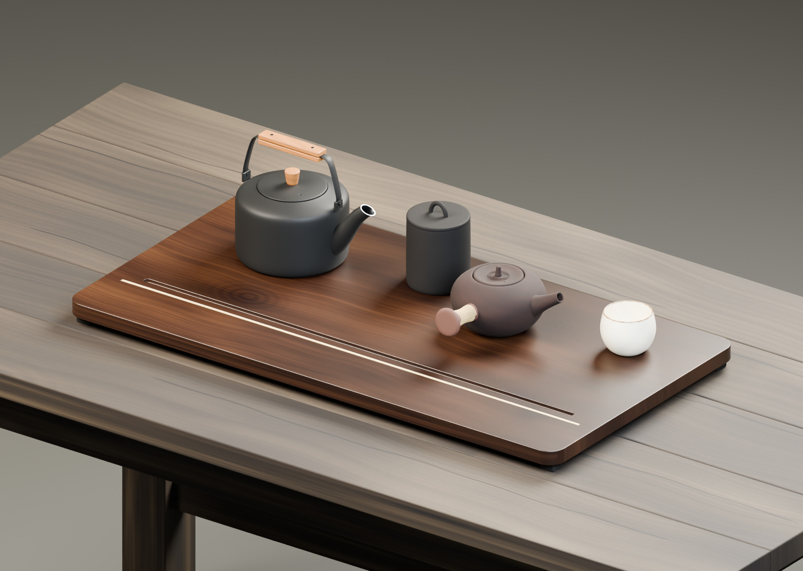

# OjaTea — asset brief and direction review

Reviewed 14 November 2026 against [plan step 1.7](../plan.md#17--review-the-direction-and-prepare-the-asset-brief). Status: working brief; visual sign-off remains open. No user approval or runtime acceptance is implied.

## Direction

A quiet, intimate tea room in warm afternoon light. A seated sencha ritual leads the composition: tactile dark clay, oatmeal ceramic, charcoal steel, pale bamboo, and warm timber. Detail comes from material variation and soft contact shadows; decoration stays sparse. Preserve readable actions and generous space around moving vessels and guidance.

Use the reference-led dark iron-brown kyūsu, charcoal kettle and plain charcoal tea box in place of the earlier generic clay, copper and green-labelled proposals. Retain the oatmeal cup, weathered plank table, and dark tray with offset pale inlay. These are the working direction for subsequent studies, subject to runtime material review.

## Review evidence and current progress

This existing Cycles render brings together four vessels, table and tray at physical metre scale. The silhouettes are distinct, the pale cup and cord break up the darker vessels, and the contrasting table/tray finishes form a coherent family. The kettle sits left, cup right, and tea box behind the kyūsu. The tray's grain and bright reflection compete somewhat with the smaller ceramic details; review roughness and exposure under the runtime renderer before changing textures.

The image is an elevated furnishing study, not the final seated view. The cup reads lighter than the intended oatmeal finish, and the kyūsu reads lighter/greyer than the dark iron-brown reference. These are review questions about lighting/material transfer, not grounds to recolour the sources yet. There is no scoop, detached-lid choreography, room architecture, UI overlay, or portrait counterpart here.

| Plan area | Evidence | Assessment |
| --- | --- | --- |
| 1.1 Direction | Direction and principles in `plan.md` | Written direction established; final review open |
| 1.2 References | Asset notes record supplied filenames and borrowed features | Object references documented; consolidated annotated board and room/light references missing; original listing provenance incomplete |
| 1.3 Palette | Role/hex table in `plan.md` | Roles defined; combined material sheet and demonstrated text/focus combinations missing |
| 1.4 Materials/silhouettes | Four vessel studies and separate table/tray, with source, exports and previews | Strong standalone progress; scoop and room/plant remain briefs |
| 1.5 Composition/light | Shared furnishing study and static bounds metadata | Physical-scale layout established; seated desktop/portrait and ritual-state studies missing |
| 1.6 Interface | Existing typography and procedural UI | Starting language exists; proposed readable sizes/backing/focus treatment not demonstrated with new assets |
| 1.7 Review | This brief and review record in `plan.md` | Brief prepared; combined scene/UI review and acceptance remain open |

Standalone asset notes report export and Blender round-trip checks. The shared study records bases within 2 mm of the service surface and footprints within the main service zone. These checks establish neither movement clearance nor browser performance. The app still contains procedural geometry and behaviour together in `src/App.tsx`; no asset loader or separated model modules exist yet. The [Phase 2C QA report](phase-2c-qa.md) also retains a focused browser verification gap for scoop cancellation and corrected renderer counters.

## Asset schedule

All dimensions below describe the studies or proposed targets, not calibrated application coordinates. Follow each linked README for exact node names and source evidence.

| Independent asset | Silhouette and material brief | Parts, openings and movement requirements | Current deliverable |
| --- | --- | --- | --- |
| [Kyūsu](../assets/kyusu/README.md) | Squat dark iron-brown clay; short tapered spout; perpendicular flared side handle with pale cord | Hollow body/open spout; separate recessed vented lid. Preserve base, opening, spout, grip, lid-seat and liquid anchors. Check handle sweep, receiving clearance, pour arc and lid rest | Blender source, GLB, textures and previews; runtime calibration pending |
| [Cup](../assets/cup/README.md) | Rounded oatmeal glaze, mineral speckles, fine brown lip and exposed foot; about 60 mm high, 78 mm wide, 180 ml brim | Real cavity and rounded lip; base/opening/liquid/sip/grip anchors. Keep liquid separate; provisional 151 ml anchor is not an agreed ritual serving volume. Check both receiving and camera-relative sip poses | Source, GLB, textures and previews; second interchangeable cup variant still needed for roadmap 3.4 |
| [Kettle](../assets/kettle/README.md) | Charcoal stainless exterior, bare steel interior/spout lip, riveted wood bail grip; about 226 × 160 × 178 mm | Open cavity/spout; separate lid and hinged bail. Preserve spout/pour/handle-pivot anchors. Check overhead clearance and grip/handle stability through tilt and return | Source, GLB, textures and previews; runtime calibration pending |
| [Tea box / caddy](../assets/teabox/README.md) | Plain finely textured charcoal cylinder, brown interior/rim, pale lid seal; about 90 mm diameter, 126 mm overall height | Hollow cavity; independent lid group including loop/insert/seal. Opening and scoop-entry anchors; lid must clear scoop access and have a reserved rest area | Source, GLB, textures and previews; runtime calibration pending |
| Bamboo scoop | Pale directional bamboo grain; distinct shallow bowl and narrow handle; avoid decoration | Separate leaf payload effect; define base, grip, bowl/deposit point and carried-leaf attachment. Size against caddy opening and kyūsu; validate two transfers and lift/clear/return cancellation | Procedural app model only; external silhouette/dimension study needed |
| [Table](../assets/table-tray/README.md) | Weathered warm plank timber with restrained knots/checks; 1.60 × 0.849 m, top at 0.72 m | Independent root and surface anchor; subdued grain at play distance. Legs/aprons/stretchers are inferred, not reference-confirmed | Source, separate GLB and previews |
| [Tray and catch pan](../assets/table-tray/README.md) | Dark warm slab, rounded edges, pale offset inlay and drainage channel; 0.84 × 0.44 × 0.036 m; no raised rim | Independent tray root and moving pan group; service/channel/pan anchors. Reserve detached-lid zones and keep feet/travel off the channel. Pan extension study is 0.20 m; no fluid simulation or new drawer interaction required | Source, separate GLB, textures and previews |
| Room shell | Warm plaster/paper, dark timber framing, restrained window treatment; intimate seated proportions | Independent architecture root; floor/origin and window/light reference. Keep walls/framing outside sight lines and vessel movement envelopes. Dimensions to be set from seated framing | Brief only; furnishings study is not a room shell |
| Decoration | One restrained plant; muted leaf green, low contrast, quiet container | Separate replaceable root; no ritual/input ownership. Place outside active silhouettes and UI zones | Procedural reference only; final study pending |

## Palette and interface handoff

Use the material families and UI targets in [plan.md section 1.3](../plan.md#13--set-the-working-palette). Forest/moss recede; timber supports the scene; dark iron-brown clay and oatmeal glaze define the focal setting; tea gold marks meaningful UI state. Authored materials supersede the old generic clay, timber and ceramic swatches. Keep leaf green for leaves and restrained decoration, not the tea box.

Retain Manrope for guidance, Newsreader italic for entry/completion and DM Mono for short labels/timers, with system fallbacks. For the next UI sample, start essential body guidance at 14–16 px and short secondary labels at 12 px, then judge at supported viewports. Use rice paper `#F0EBDC` and muted parchment `#C5C0B2` on reliable forest `#20271F` backing; tea gold `#D8C497` for visible focus plus explicit labels. Demonstrate actual composited contrast and focus rather than assuming opaque swatch contrast proves translucent UI legibility. Do not adopt the prototype's faint 8–11 px hints as final guidance.

Entry, active ritual and completion should share the same backing, spacing, border and focus language. Entry/completion can use expressive italic type, while instructions stay direct and readable. Replace public development-phase labels with ritual language when implementing the interface pass. Keep the mark provisional until its meaning is verified.

## Composition and clearance handoff

Start from the existing seated camera and layout, not the elevated render camera. Use the shared study as a relative-scale reference: kettle left/rear, kyūsu central, cup right, caddy and scoop accessible. Its table-plus-tray service surface is 0.756 m above the floor; conversion to the procedural scene needs explicit calibration, not a blind copy of physical coordinates.

Keep room, furniture and controllers independent. Use a diffused upper-left/front key with gentle fill, soft contact shadows and a quiet background. The existing HDR remains provisional. Avoid placing the brightest window behind essential text.

Next review artifacts must show:

- Desktop landscape and narrow portrait at entry, leaf transfer, water pour, tea pour, held-cup sip and completion. Include actual UI zones and visible keyboard focus.
- Source spout to receiving opening, kettle bail and kyūsu handle sweeps, scoop pickup/cancellation paths, detached-lid rest footprints and cup return. Static footprint checks cannot substitute for these movement checks.
- Space for entry copy, lower guidance/progress and controls, including the held cup at the nearest camera pose. Demonstrate reduced-motion presentation as well.

## Production boundary and remaining decisions

Retain editable Blender sources and export independent asset-only GLBs to `public/models/`. Use metres, Blender +Z up / GLB +Y up, base-at-zero contact, stable named parts and semantic anchors. Exclude cameras, studio lights and reference imagery. Bake unsupported procedural shading into portable PBR maps; preserve interior geometry. Existing anchor names differ by asset, so the later manifest must map roles explicitly rather than assume one common naming pattern.

Application wrappers own input, outer movement, lids, progress and ritual state. Visual assets do not contain ceremony rules. Liquid, leaves, steam and streams remain separately driven runtime effects. Authoring anchors are calibration candidates, not validated animation endpoints.

Set export/texture/resource budgets in roadmap 3.3 after measuring the running scene; current study triangle counts and file sizes are not production targets. Keep photographs as visual references outside runtime packages. Record original source/creator/licence where available, and review any third-party production asset separately; filenames alone do not establish reuse rights.

Remaining visual questions: final room dimensions/window treatment; seated framing and portrait arrangement; scoop size; acceptable tray sheen and ceramic colour under runtime lighting; final text sizes/backing; mark meaning; calibrated lid-rest and movement envelopes. Resolve these with one annotated reference/material board and a combined scene/UI study before claiming step 1.7 complete. Then follow the planned separation, asset contract and two-cup proof before expanding production.
