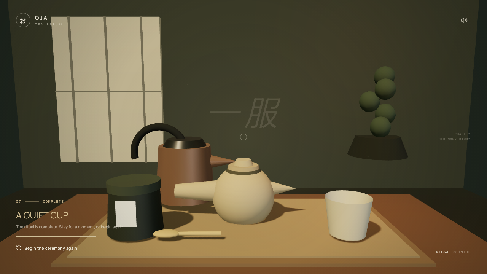
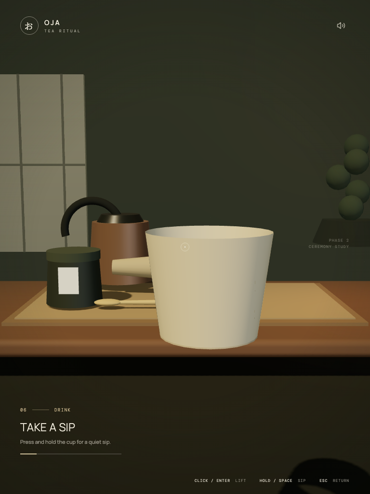
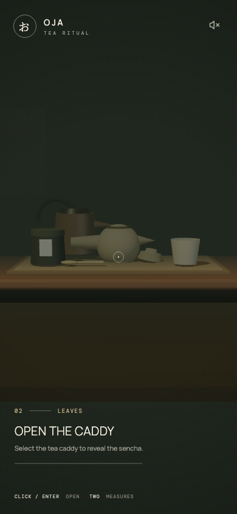

# Phase 2C — ceremony verification

Run date: 17 October 2026. Scope: the desktop-first procedural prototype in Chromium, including portrait presentation and reduced-motion mode. This is the gate into Phase 3 asset production.

## Result

- Production build passed.
- 19 unit tests passed after the final changes.
- The full Chromium run passed all 11 scenarios in 302.4 seconds, with no retries, skips, flaky results, or unexpected failures. Raw results are preserved in [qa/full-results.json](qa/full-results.json); the full interactive report is in `playwright-report-full/index.html`.
- One verification gap remains: after the full run, a horizontal clearance waypoint was added to scoop cancellation and the performance counter was corrected to aggregate all rendering passes. The build/unit checks passed, but the additional focused browser run was not approved. Those two final adjustments have not received a live browser rerun. The normal ceremony, mouse/keyboard parity, responsive layouts, and interrupted interaction flows passed before those localized adjustments.

Phase 2C's main functional checks pass. Final sign-off should follow one focused browser rerun for the two adjustments above; this report does not certify production performance or additional browser engines.

## Recorded baseline

| Measurement | Observed |
| --- | --- |
| Scene ready, first visit in fresh Chromium contexts | 1.997–2.443 seconds; development server, local HDR, includes navigation and shader/scene initialization |
| Completed desktop keyboard ceremony | Median frame interval 80.7 ms; p95 91.0 ms |
| Second completion in same keyboard context | Median frame interval 80.5 ms; p95 88.4 ms |
| Completed desktop mouse ceremony | Median frame interval 114.2 ms; p95 127.0 ms at 1440×900 |
| Completed portrait ceremony with reduced motion | Median frame interval 63.2 ms; p95 70.4 ms |
| Renderer resource counts over repeated keyboard completion | 66 geometries / 6 textures before and after restart/recompletion; no resource-count growth observed |
| Production JS | Approximately 1.166 MB uncompressed / 329 KB gzip |
| Production CSS | Approximately 5.26 KB uncompressed / 1.95 KB gzip |
| Locally bundled HDR | Approximately 1.48 MB |
| Draw calls and triangle count | Initial sample measured only the final shadow-blur quad and is invalid as a scene total. Aggregation was corrected; a new live measurement is pending. |

The automated rendering cadence above is well below the production 60 FPS target. It is an observation from this automated development browser, not a measurement on representative desktop/mobile hardware. Hardware profiling is needed before making a performance claim. Resource counts are bounded in the tested cycles; they do not constitute a JS heap leak audit.

## Visual evidence

Desktop completion:



Portrait sip after release and recovery:



390×844 presentation fallback:



## Coverage

| Area | Verification |
| --- | --- |
| Ceremony | Real input and animation from entry through both scoops, water, a real 20-second steep, tea, sipping, completion, and restart |
| Input parity | Complete mouse-only and keyboard-only ceremonies; mixed pointer/keyboard interruptions |
| Recovery | Escape during scoop and vessel movement, early pour/sip release, cancellation and relift of a partially used cup |
| Browser events | Simulated blur and visibility events, including pausing steep time while hidden; the tests do not switch OS windows |
| Input guards | Repeated selection during movement, inactive object selection, held-key handling, and native button keyboard focus |
| Camera | No view movement while a held object is manipulated; resize during a vessel gesture; camera-relative portrait cup pose |
| Presentation | 1440×900, 1280×720, 1024×768, 768×1024, and 390×844; projected selectable objects and non-overlapping HUD rectangles |
| Reduced motion | Full portrait ceremony; faster object movement and suppressed decorative steam/dust |
| Restart | Physical home positions, ceremony state, liquid progress, leaves and timer reset; bounded renderer resource counts across repeat completion |
| Geometry | Both spouts validated at their final tilt; upright, below-target, missed, and excessive-height pours rejected |

The browser tests use actual keyboard and mouse input. They inspect read-only development scene diagnostics rather than writing the store or skipping state transitions. The only browser simulation replaces the visibility signal and dispatches browser lifecycle events to exercise interruption handling.

## Corrections made during QA

- A cancelled partial sip previously ended in a non-selectable cup state. It now returns to idle while retaining sip progress.
- Disabled vessels no longer process another vessel's shared release events or display its stream.
- The water spout dipped just below the kyūsu opening at its final tilt. Raising the kettle's ready pose keeps one continuous hold valid.
- Liquid transfer and stream visibility now use the same world-space alignment check.
- Completed transfers resolve to exact full progress. Negative and non-finite transfer/timer values are rejected.
- Returned vessels snap to their exact home transforms before changing the ritual step.
- Keyboard scene shortcuts ignore focused UI controls, while entry and restart restore focus to the scene.
- Responsive camera positioning no longer reinitializes during a resize; the portrait cup pose leaves room around the cup.
- The scoop handle clears the rim during pickup, and the caddy lid moves farther aside to clear top entry.
- Scoop cancellation now lifts vertically, clears the caddy horizontally, and then descends to rest. The final horizontal-clearance addition awaits the focused live rerun noted above.
- The room's existing lighting HDR is bundled locally so scene initialization does not depend on a third-party host.

## Reproduce

```sh
npm run build
npm test
npm run test:e2e
```

To close the remaining verification gap:

```sh
npm run test:e2e -- --grep '1440|1280|interruptions' --output test-results-refinement
```

Playwright uses a single Chromium worker and port 4173. Screenshots, read-only scene samples, frame timing samples, and scene-ready timing annotations are attached to its HTML and JSON reports. `npm run test:e2e:report` opens the interactive report.

## Scope limits and later work

- Mobile-sized testing covers presentation with a desktop input model. Physical touch devices, Safari, Firefox, mobile GPU targets, and full touch controls are not certified by this pass.
- Blur/visibility recovery is exercised with browser events; real OS task switching remains a useful manual acceptance check.
- Frame timings are development Chromium regression samples, not certification of the production 60 FPS target or JS heap stability.
- Google Fonts remains an optional network resource with system fallbacks. The scene itself uses local lighting data.
- Sound controls remain a prototype affordance; audio production belongs to Phase 5. Asset fidelity, more convincing liquids, and lighting polish remain in Phases 3–4.
- The large Three.js application chunk still produces Vite's size advisory. Code splitting and broader performance work remain in Phase 7.
